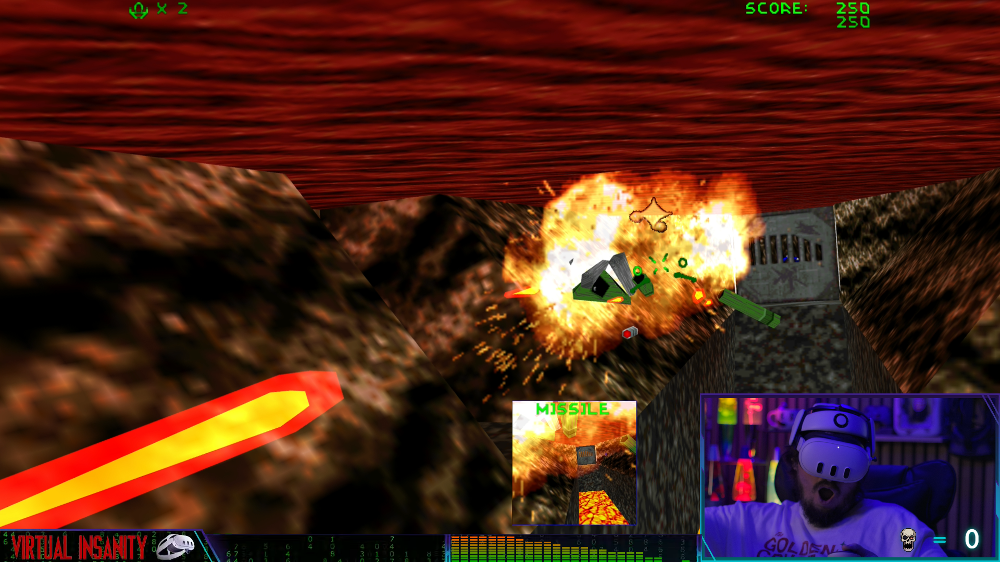
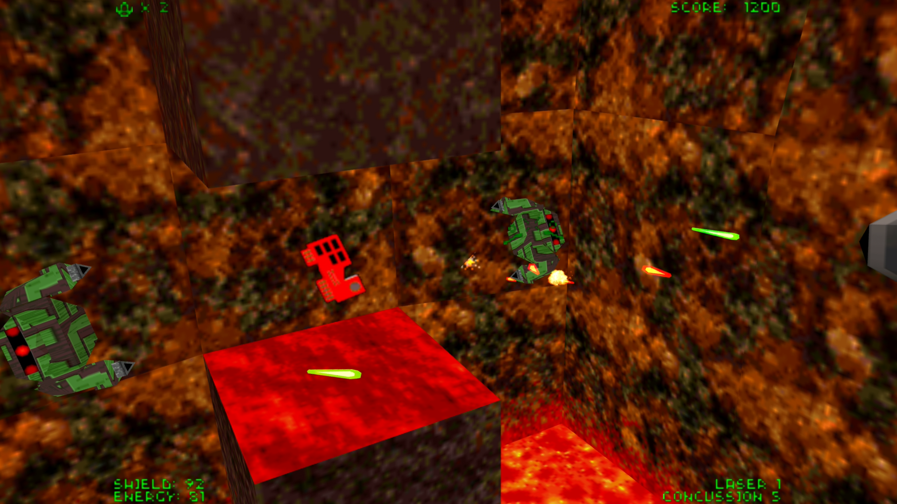
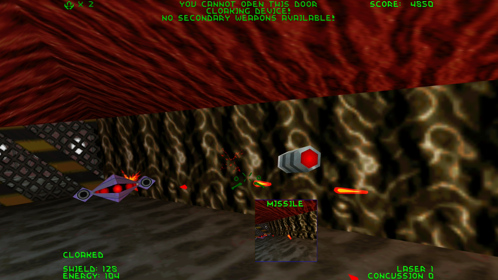

# Descent 1 & 2 VR

Descent and Descent 2 in your VR headset, on PC VR or standalone on a Meta Quest 3 or a Steam Frame, built on [DXX-Redux](https://github.com/dxx-redux/dxx-redux), with your own copy of the games. A Game Or Die VR port.

**Watch the install and gameplay video:** [I Put Descent in VR and It's Wild](https://youtu.be/JQkiFOKlkl4)

## Install

1. Download `Descent 1 and 2 VR Installer.exe` from [Releases](../../releases) and double-click it. (Windows may say it protected your PC: choose More info, then Run anyway. The installer is not code-signed.)
2. Press **INSTALL**.
3. Start Virtual Desktop or SteamVR, put the headset on, and press the big button again (now **PRESS START**), or start **Descent VR** or **Descent 2 VR** from the desktop shortcut or your Steam library.

The installer finds your games by itself: every Steam library, GOG, a disc install, or any folder you point it at. It adds a VR folder inside each game's own folder, desktop shortcuts, and entries in your Steam and SteamVR library. Nothing from the games is copied or changed, and your pilots and saved games are never touched. You need Descent and/or Descent 2 for PC (Steam, GOG or disc), a PC VR headset with an OpenXR runtime (Virtual Desktop or SteamVR), and Windows 10 or 11.

### Installing by hand

Download the newest `-PCVR.zip` from [Releases](../../releases), unzip it anywhere and double-click `Setup.bat`. It does the same as the installer; drag a game folder onto its window if it cannot find one by itself.

To uninstall, double-click `Uninstall.bat` (in the download or in either game's VR folder): it removes everything Setup added and keeps your pilots and saves. If something goes wrong, `Collect logs.bat` puts the logs in one zip on your desktop to send us.

<a href="https://youtu.be/JQkiFOKlkl4"></a>

 

Descent (left) and Descent 2 (right), as the observer view shows them on the monitor.

## What you get

* Both games in full stereo at your headset's frame rate, with head tracking
* Aim with your controller or your head, or fly the way Parallax made it: a Play style question (Modern or Classic) the first time you start a new game, changeable any time
* **View:** no cockpit, a Modern cockpit built round you with live gauges in the dash, the original Classic cockpit picture in front of you, or your ship from behind, near or far
* **Game Tome:** the game's own manual as a book in your hand, with our pages on playing in VR and pages for your own notes, written with a pen. Setup makes it from the manual.pdf that comes with your copy
* Menus, briefings, movies and the HUD on a screen in front of you; point and click with the right grip
* Switch Game: jump from Descent to Descent 2 and back from the main menu
* A steady full screen view on your monitor for streaming and recording (Alt+Enter for a window)
* Photo mode, a left-handed mode (Leftorium), Swivel chair (turn the ship by turning your body), Invert look, vibration, a Ship bob switch, and a Controls page to put any action on any button, the grips included
* **Flying and World Size:** Head steering (the ship turns where you look), Motion flying (left grip and move the controller up or down to slide, right grip and twist to bank) and World size (scale the mine around you for stronger depth)
* Played with Meta Quest Touch controllers; Valve Index and Steam Frame layouts are included

## Standalone on Meta Quest 3

Download the newest `-Quest.zip` from [Releases](../../releases) and unzip it on your PC. Turn the headset on, plug it into the PC with a USB-C cable, and double-click `Setup.bat`. Setup finds your Descent and Descent 2 on the PC the same way, installs the app on the headset and copies your game files over (the first time, put the headset on and allow USB debugging). The headset needs Developer mode, turned on once in the Meta Horizon phone app; the Quest download's README walks through it. Run it again after an update: it copies only what changed and keeps your pilots and saved games, with a copy of them on the PC. On the headset, open Descent 1 & 2 VR from Library, Unknown Sources, and pick a game. Setup also makes each game's Game Tome on the PC and copies it over. The Quest version has everything above except the observer view.

## Standalone on Steam Frame

The Quest download runs on a Valve Steam Frame with no PC, under Lepton (the Frame's Android layer), installed over Wi-Fi. On the Frame, turn on Developer Mode and set a user password (Settings, Developer), and start **Lepton Development** from its library. Then double-click `Setup Steam Frame.bat` on the PC and type the Frame's name (Settings, System, Hostname): it installs the app and copies your games and their Game Tomes over. Start it with `Start on Steam Frame.bat`. It runs at 72 Hz, the Frame's rate for standalone games.

## Controls (Meta Quest Touch)

| | |
|---|---|
| Left stick | fly forward and back, slide left and right |
| Right stick | turn, nose up and down |
| Left grip / right grip | raise / lower the ship |
| Both grips | recenter |
| Right trigger / left trigger | fire primary / secondary weapon |
| A / B | bank left / right |
| X / Y | next primary / next secondary weapon |
| Left stick click | afterburner (Descent 2), flare (Descent) |
| Right stick click | drop a bomb |
| Menu button | pause menu |

A, B, X, Y, the stick clicks and the grips can be changed in the pause menu under VR Options, Controls. On the keyboard, Home recenters. Fly drones? Stick layout: FPV (drone) on the same page puts climb and turn on the left stick, pitch and bank on the right, and forward and back on the grips.

## For tools and hubs

Setup can be driven without questions, the same way in every Game Or Die port. From the release folder:

| | |
|---|---|
| `Setup.bat -Quiet` | find the games and install |
| `Setup.bat -Quiet -GamePath "<folder>;<folder>"` | install for these game folders only |
| `Setup.bat -Detect -Json` | change nothing; report the games and the install as JSON |
| `-Json` on any of these | print the result as JSON on stdout and nothing else |
| `-AddToSteam` (with `-CloseSteam`) | also add the Steam library entries (closing Steam to do it) |
| `-NoShortcuts`, `-NoSteam` | skip the desktop shortcuts or the Steam entries |

Uninstall: `powershell -File "<game>\VR\tools\setup.ps1" -Uninstall -Quiet`. Exit codes: 0 done, 1 no game found, 2 error. Each VR folder holds `version.txt`; the JSON lists each game's folders, its installed version and its launcher. Releases are tagged v1.0, v1.1 and so on, with the SHA-256 of each file in the release notes.

## Building from source

Windows, Visual Studio 2022 or later (or its Build Tools) with the C++ workload, and [vcpkg](https://vcpkg.io) with `VCPKG_ROOT` set. Then:

```
build-win.cmd d1
build-win.cmd d2
```

The game links GameOrDieXR, Game Or Die's VR library (the OpenXR layer, the observer view, the controller mapping, the Game Tome's book). Its source is not published: the prebuilt library is in `vr/lib`, its interface is `vr/vr_xr.h` and `vr/vr_handmap.h`, and the build uses them.

The Quest version's engine changes are in the same tree (`__ANDROID__`), with its Android project in `platform/quest`. Its closed parts (GameOrDieXR for Android and the game picker) are not published; the engine's Android build links the prebuilt GameOrDieXR in `vr/lib/android`.

## Credits

Descent and Descent 2 by Parallax Software. The engine is [DXX-Redux](https://github.com/dxx-redux/dxx-redux) (Arne de Bruijn, Sirius, Ronald M. Clifford, Daniel Keymer and its contributors), built on [DXX-Retro](https://github.com/CDarrow/DXX-Retro) by Catherine Darrow and on [DXX-Rebirth](https://www.dxx-rebirth.com) and D1X/D2X before it. VR by Game Or Die. The Quest version uses [SDL](https://www.libsdl.org), [sdl12-compat](https://github.com/libsdl-org/sdl12-compat), [PhysicsFS](https://icculus.org/physfs/), [TinySoundFont](https://github.com/schellingb/TinySoundFont) and the [GeneralUser GS](https://schristiancollins.com/generaluser.php) sound font by S. Christian Collins for the music; the full list and licenses are in the Quest download.

## License

The engine and our changes to it are under the Parallax license and the D1X-Rebirth license (`COPYING.txt`, and `d2/COPYING.txt` for Descent 2): non-commercial use only, never sold, and the source of any modified version freely and publicly available. You need your own copy of the games.

Game Or Die's own files (the GameOrDieXR library, the game picker, the splash art, the Game Tome's book and the installers) are all rights reserved: they may be shared only unmodified, as part of the Descent 1 & 2 VR release, and may not be modified, decompiled or used in other projects (see `LICENSE-GameOrDie.txt` in the release). The Game Or Die name and logo are not licensed: a copy or a changed version of this port must not present itself as Game Or Die's.

---

**Get an email when the next port ships:** follow [Game Or Die on Patreon](https://www.patreon.com/cw/GameOrDie) for free. Ports are never paywalled.
